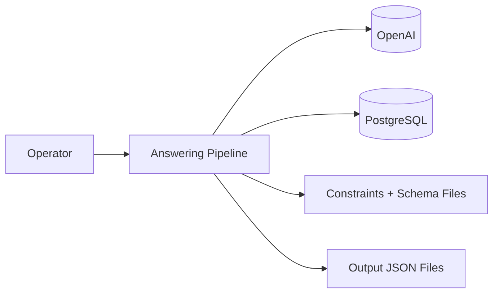
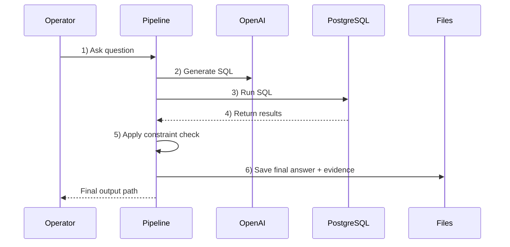

# Grid Copilot System Architecture

Lightweight architecture view with key data flow and documentation screenshots.

## 1) Core Components

Component notes:

- Operator: asks a monitoring question (with run_id and optional node_id).
- Answering Pipeline: orchestrates SQL generation, SQL execution, constraint decision, and final response packaging.
- OpenAI: generates SQL and (optionally) final response text.
- PostgreSQL: executes read-only SQL over approved KPI views.
- Constraints + Schema Files: provides view schema, templates, id mapping, and thresholds/rules.
- Output JSON Files: keeps auditable artifacts for SQL result, decision label, and final answer.

## 2) Simple Data Flow

Flow notes:

- Step 2 uses context files in agentic_ai/M2 to keep SQL bounded to allowed views.
- Step 5 classifies result into stable, vulnerable, unstable, or constrained.
- Step 6 writes structured JSON outputs so every answer can be traced back to SQL and metrics.

## 3) What Gets Saved

- SQL drafts and refinement logs: logs/sql drafts, logs/refinement.json
- SQL results: outputs/sql results
- Constraint decisions: outputs/constraint checks
- Final answers: outputs/final answers

## 4) Photos / Screenshots To Add

Add these screenshots under docs/screenshots to make architecture evidence clearer:

1. Database view (PostgreSQL tool or query UI)
    - Suggested file: docs/screenshots/postgres_kpi_views.png
    - Capture: list of allowed views (v_voltage_violations, v_soc_summary, v_dr_power_summary, v_voltage_control_summary, v_kpi_run_summary)

2. SQL generation evidence
    - Suggested file: docs/screenshots/sql_draft_example.png
    - Capture: one file from logs/sql drafts showing generated query text

3. SQL execution output JSON
    - Suggested file: docs/screenshots/sql_result_json.png
    - Capture: outputs/sql results/q1.json (columns, row_count, rows preview)

4. Constraint decision output
    - Suggested file: docs/screenshots/constraint_decision_json.png
    - Capture: outputs/constraint checks/q1.decision.json (label + metrics)

5. Final text answer output
    - Suggested file: docs/screenshots/final_answer_json.png
    - Capture: outputs/final answers/q1.json (question, final_answer, constraint_label)

6. Optional report page
    - Suggested file: docs/screenshots/output_summary_page.png
    - Capture: outputs/summary/index.html

## 5) One-Line Summary

Grid Copilot takes a question, generates and runs SQL, checks constraints, and writes a grounded final answer package.
